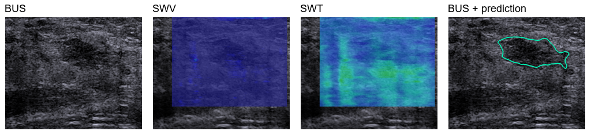
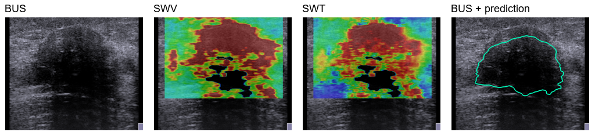

# D2-Seg: breast ultrasound segmentation examples

Three paired ultrasound examinations from the 76-case test split. Each row shows B-mode ultrasound (BUS), shear-wave velocity (SWV), shear-wave time (SWT), and the final segmentation on BUS (green contour). Display panels are cropped and resized; Dice is evaluated on the original BUS grid.

Predictions come from the 100-epoch, constant-learning-rate three-branch U-Net++ model (student seed 124) with nine-candidate MedGemma review. Examples were selected near the 25th, 50th and 75th percentiles of case-level Dice to show a range of outcomes. Mean Dice across all 76 cases was 70.54%.

### Example 1 — Dice 63.17%

### Example 2 — Dice 74.74%

### Example 3 — Dice 83.66%

