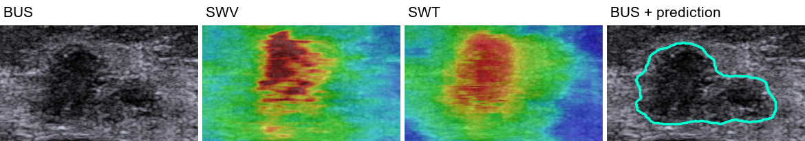

# D2-Seg: breast ultrasound segmentation examples

Three paired ultrasound examinations from the 76-case test split. Each row shows B-mode ultrasound (BUS), shear-wave velocity (SWV), shear-wave time (SWT), and the final segmentation on BUS (green contour). Display panels are cropped and resized; Dice is evaluated on the original BUS grid.

Across the 76-case test split, D2-Seg achieved a mean Dice of **72.10%** and a mean IoU of **58.11%**. The examples below show the three cases with the highest Dice in that evaluation.

### Example 1 — Dice 93.13%

### Example 2 — Dice 92.70%

### Example 3 — Dice 92.06%

